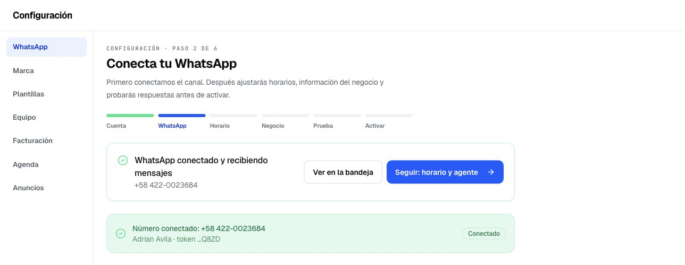
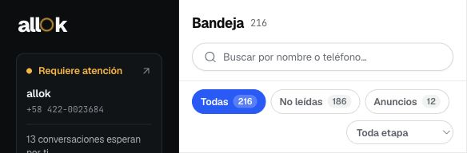

# Allok CRM: make first value obvious

Audit and architecture recommendation, 2 October 2026. No application changes, migrations, settings changes or real messages were performed.

## Executive summary

- Keep **one application repository**, with organization-level vertical configuration. No vertical forks, monorepo conversion or new microservices now.
- Improve the assisted customer handoff first. `ACTIVE.md` puts public self-service on hold until three paying bespoke systems. The future self-service flow below is a design, not permission to enable it.
- Reuse the existing WhatsApp bridge, onboarding table, readiness API, inbox and durable agent queue. Most of the needed system already exists.
- Fix unsafe defaults and misleading success states before changing navigation: new assisted workspaces can start with AI enabled; manual connection success does not prove webhook activation.
- Recover the existing knowledge-save error fix rather than writing another one. Local commit `c7f7a68` is not in audited deployed main.
- Reduce the customer journey to **Connect → Business information → Test → Inbox**, with account/workspace creation before it and explicit consent before customer-facing AI starts.
- A connected number, a received message and a delivered reply are different facts. Display each with evidence and a specific next action.
- Put human takeover in the conversation header/composer. A CRM reply should have an explicit, safe pause policy, not rely on finding a switch in a details drawer.
- Use one understandable inbox count: conversations needing attention. Do not present unread-message totals as conversation counts.
- Aim for a verified setup roundtrip within 5–10 minutes for an eligible, already-provisioned business. Measure real customer activation separately; Meta review and customer arrival are outside that promise.

## Scope and confidence

Source of truth: `origin/main` commit `ee76c620b409a435c4773810782fdd01ecba194f`, isolated branch `codex/allok-ux-audit-20261002`. The original checkout at `fix/kb-save-feedback` was over 100 commits behind and was left untouched.

Both `crm.allok.fun/api/health` and `whatsapp.allok.fun/api/health` returned version `1.3.0`, commit `ee76c62`, `agentQueue: ok`. This proves the reported deployment revision and that health endpoint's queue check, not message delivery or tenant isolation. An already-open inbox tab showed an older build; fresh settings/overview pages showed `ee76c62`.

Evidence labels used below:

- **Observed:** live login, inbox list, WhatsApp settings, agent configuration and overview; mobile 375×812 and desktop. No conversation was selected because selection marks it read.
- **Code:** traced behavior at the pinned revision; not an assertion that an error occurred in production.
- **Proposal:** a recommended change, not something implemented or measured.
- **Unverified:** no new account, Meta consent, connection replacement, AI activation, save, send, billing transaction or end-to-end live roundtrip was attempted. No production DB queries were made. Landing/conversion outside this repository was not audited.

Official Meta pages for [Embedded Signup v4](https://developers.facebook.com/documentation/business-messaging/whatsapp/embedded-signup/version-4) and [Business App onboarding](https://developers.facebook.com/documentation/business-messaging/whatsapp/embedded-signup/onboarding-business-app-users) were unavailable to the research tool (429/503). No claim about current Meta approval requirements, version deadlines or coexistence eligibility is independently verified here. Validate those against the official documentation and a real approved test account before shipping changes to that integration.

## Biggest five problems, ranked

| Rank | Problem and evidence | Minimum useful correction | Impact |
|---|---|---|---|
| 1 | **AI can start before explicit activation in assisted provisioning.** `default-profile.ts:8` is `enabled: true`; `on-signup.ts:112–119` overrides it only for `selfServeTrial`. The auth hook excludes admin-created workspaces from that trial. Billing/hours still gate actual sends, so this is a conditional risk, not a proven unwanted production reply. | New customer workspaces start paused. Do not change existing enabled users. Keep the existing server activation checks. | Avoid surprising a customer's contacts before business information and consent are ready. |
| 2 | **Knowledge can disappear on a failed save.** `agent-client.tsx:438–459` clears fields without checking HTTP success. The local `c7f7a68` fix already preserves input and reports failure. | Port the existing small fix onto current main, verify conflict resolution and QA/block save failures. | Prevent lost work and a readiness step that stays incomplete without explanation. |
| 3 | **Connection/activation success has weaker evidence than the wording suggests.** Manual settings validates token→phone, saves credentials and swallows WABA subscription failure; readiness checks credential status; onboarding ends at first inbound, not a reply. | Distinguish credentials saved, callback verified, received and delivered. Reuse the verified Embedded Signup primitives where appropriate; preserve the external handover contract. | Stop owners believing WhatsApp is operational when only one leg works. |
| 4 | **Human control is hidden and inconsistent across channels.** Phone echoes pause AI; CRM sends do not. `patchConversation` ignores API errors. Fresh pre-send pause checks already exist and must remain. | Visible “Tomar conversación” / “Devolver a allok”; pause policy applied server-side across operator text/media/structured sends; confirmed state or visible error. | Prevent AI/human overlap and make recovery understandable. |
| 5 | **Configuration overwhelms the owner.** Fixed step 2/6, duplicate connected cards, always-visible technical reconnection fields; agent page puts prompts/activators/provider before useful business information. | Derive progress from readiness, one connection card, advanced support disclosure, business-first agent editing. | Fewer decisions, less scrolling, clearer next action. |

P0 below means an activation/safety blocker for the affected path. It does not mean a verified production outage. P1 serious friction, P2 usability/accessibility, P3 polish.

## 1. Existing system, traced rather than inferred

| Area | Actual implementation | Evidence |
|---|---|---|
| Application | Next.js 15 App Router, React 19, TypeScript, Tailwind 3, Radix components, Drizzle/Postgres, Better Auth, Vitest, pnpm. Version ranges are declared dependencies, not a production binary inventory. | `package.json`, `tsconfig.json` |
| Frontend | Server route pages load scoped data; client components handle configuration/inbox; organization event stream updates messages/status. Allok-specific UI in `components/agencia/allok`; existing design source is `design/design.md`, tokens in `globals.css`. | `src/app/(app)`, `components/inbox/inbox-client.tsx`, `server/events`, `components/app-nav.tsx` |
| Backend | Route handlers under `app/api`; session/owner/plan wrappers; domain services under `server`. Some inherited and agency paths coexist. Preserve those contracts rather than moving folders during UX fixes. | `lib/api.ts`, `server/agencia`, `CLAUDE.md` |
| Organization | One organization per new SaaS business, owner membership, slug/subdomain, seeded sales stages. Legacy mode supports a dedicated organization. A deployment is not inherently one customer. | `server/auth/on-signup.ts:43–120`, `lib/tenant-host.ts`, `lib/db/schema.ts:72–79` |
| Auth/roles | Better Auth email/password. Tenant host plus database membership resolves org/role, not the cookie alone. Owner-only settings; members require the appropriate SaaS plan. Platform admin is a separate allowlisted-email path. Public self-service is flag-gated. | `lib/auth/index.ts:157–205`, `lib/auth/session.ts:43–94`, `app/api/saas/businesses/route.ts:16–43` |
| Tenant isolation | `scoped()` requires an org ID and composes predicates; host membership checks; unique phone-number credentials. This is application-enforced scoping, not universal database enforcement. Bot/provision endpoints are privileged platform boundaries. | `lib/db/tenant.ts:11–22`, `server/bot/auth.ts:52–70`, `server/whatsapp/credentials.ts:37–111` |
| WhatsApp | Fixed-host Embedded Signup bridge; HMAC state, code exchange, token/WABA/phone verification, encrypted credential storage, WABA subscription/callback verification, mode-specific registration. Coexistence keeps the existing Business App; Cloud API is separately configured. | `app/conectar-whatsapp/page.tsx:15–19`, `server/agencia/whatsapp-signup/complete.ts:120–362` |
| Ingest/send | Verify webhook path token and Meta signature; route by Meta phone ID; idempotent message insert; contact/conversation upsert; statuses handled separately. Sends re-check org, sandbox, pause, billing, hours and messaging window. | `app/api/webhooks/wa/[webhookToken]/route.ts:48–119`, `server/inbox/ingest.ts:249–304`, `server/inbox/send.ts:90–170` |
| AI | Internal OpenAI-compatible adapter with configured provider/fallback, or external bot/Nea. Nea dispatch shares `buildBotContext` / `buildBotProfile` with bot endpoints; external brain suppresses internal brain to avoid duplicate responders. | `lib/ai/index.ts`, `lib/env.ts:185–224`, `server/ai/pipeline.ts`, `server/ai/dispatch-payload.ts`, `server/bot/context.ts`, `server/bot/profile.ts` |
| Queue | SaaS `agent_job` persisted in Postgres; active-conversation uniqueness, `FOR UPDATE SKIP LOCKED`, configurable worker concurrency (default 4). Runs in the long-lived app process. Interrupted/stale jobs become `needs_review`, not blindly resent. Some lab work remains process-local. | `lib/db/schema.ts:113–142`, `server/ai/worker.ts:37–209`, `instrumentation-node.ts:7–35` |
| CRM | Contacts, conversations/messages, leads/pipeline; booking and ad attribution optional. Inbox excludes lab `isTest` conversations. Existing contact details/qualification can be reused. | `lib/db/schema.ts`, `server/inbox/queries.ts:75–79`, `server/bot/ficha.ts` |
| Agent | Name, tone, greeting, instructions, escalation rules, KB QA/free text, activation messages, allowed numbers, provider/BYOK, schedule and global enable. Readiness requires a recent simulation ≥80 with zero red cases. | `components/agent/agent-client.tsx`, `server/agent/default-profile.ts`, `server/readiness.ts:84–201` |
| Billing | Stripe checkout/webhooks plus platform-assisted billing; plan entitlements and self-serve trial state. Billing metadata shares `organization.metadata` with branding and vertical. No pricing change is proposed. | `server/saas/billing.ts`, `server/agencia/entitlements.ts`, `app/api/saas/billing/webhook/route.ts` |
| Analytics | Product outcome/sales/ad reports, lab scores, live test timestamps, operational attention state. Not yet an authoritative complete activation funnel. | `server/analytics/*`, `components/agencia/allok/control-center.tsx`, `server/onboarding/whatsapp-onboarding.ts` |
| Deployment | Node 22 Alpine standalone Docker image, migration script at boot, persistent `/data/media`, health endpoint; Coolify long-lived runtime. Local disk media and in-process events constrain multi-replica operation. | `Dockerfile`, `instrumentation-node.ts`, `server/events/bus.ts`, `lib/env.ts` |
| Vertical | Organization metadata supports `inmobiliario`; deployment default seeds it for new orgs. Optional realty schema/catalog/matching, guarded by vertical and plan. It is already a module, not a fork requirement. | `server/agencia/vertical.ts:19–108`, `server/realty/guard.ts:19–38`, `lib/db/schema.ts:1327–1610` |

### Configuration ownership

Do not show these as ordinary customer setup fields:

| Scope | Configuration |
|---|---|
| Operator/deployment | `APP_BASE_URL`, DB/auth/encryption secrets, webhook verify token / Meta app secret, app/config IDs, Graph version, shared AI provider, bot/provision keys, Nea URL, WAHA, media storage, worker concurrency, Stripe and connector credentials. Values were not read or copied. |
| Deployment product policy | `ALLOK_SAAS_MODE`, `SAAS_SELF_SERVE`, host/admin configuration, `BRAND`, `DEFAULT_VERTICAL`; `CHANNELS`, `AGENDA`, `ATRIBUCION`. Defaults and supported surfaces are controlled here; a feature flag is not customer data. |
| Workspace | Name, branding, owner/team/roles, subscription, vertical selection, business timezone. |
| WhatsApp number | WABA/phone identity, mode, token lifecycle and receiving/sending evidence. Today credential schema is one number per organization; do not advertise multi-number workspaces. |
| Agent | Business knowledge, tone, permitted actions, escalation, response schedule, global pause. Provider/BYOK and activation-message triggers are advanced/operator controls. |
| Conversation | Contact/qualification/stage, human takeover, local AI pause, message window and delivery/errors. |

Documentation drift: older project prose describing only one business and no durable queue is no longer a complete account of SaaS source. Update that prose after the audit direction is accepted; do not redesign the queue from an outdated description.

## 2. Current onboarding audit

Click counts are lower bounds from route/component tracing. Meta's external screens, approval delays and admin communication are not fabricated as fixed click counts.

| Step | Current experience, fields and dependencies | Problem | Severity | Proposed change |
|---|---|---|---|---|
| Discovery/signup | Public `/register` with self-service off leads to contacting allok, not instant registration. Admin creates business with name/email/password (≥8 chars), one submit. Future self-service uses those three fields. | A zero→account <10min claim does not apply to today's assisted mode. | P1 future self-service; intentional now | Explain assisted setup clearly; deep-link customer handoff into setup. Do not enable public signup. |
| Login/recovery | Email/password, one submit; forgot-password link goes to support. Mobile login fits 375px. | Support-dependent recovery becomes a blocker at self-serve scale. | P1 future | Keep assisted recovery for now; build tested verification/recovery before reopening signup. |
| Workspace | Created by signup hook, slug collision handled, owner assigned, stages/default agent seeded. | Admin path can seed enabled AI; default outside-hours schedule may be surprising. | P0 safety, code | Pause new workspaces. Show the actual timezone and next active period before consent. |
| Start connection | Settings → connect CTA → fixed-host bridge → Meta → return. Coexistence offered by default when configured. Depends on approved Meta app/config, state/session, billing eligibility and correct host. | Popup cancel, expired state, permissions or wrong business may leave the owner unsure whether anything was saved. | P1 | Preserve business input; show resumable current stage and clear retry/support action. |
| Manual fallback | Three fields (WABA ID, Phone Number ID, token), “Probar conexión” then “Guardar conexión”; token→phone check, encrypted save, best-effort subscribe. | Technical form always visible, even already connected; success may mean credentials saved without callback proof. | P0 for failed direct subscription; P1 disclosure | Support-only disclosure. Show credentials saved as pending until callback verified; do not break agency override handover. |
| Connection proof | Onboarding `pendiente/conectado/webhook_ok/primer_mensaje/error`; send a message from another phone; SSE with polling fallback. | First inbound closes this stage, no matching delivered outbound milestone. History imports are not live proof. | P0 for full activation definition | Live receiving and delivered reply checkpoints, correlated to the current number. |
| Configuration progress | Live page says step 2/6 even when receiving; duplicate connected cards. Overview separately displays 6/8 readiness. | Two progress models compete; returning owners see setup again. | P1 observed | One server-derived next action; completed connection becomes maintenance, not onboarding. |
| Business/AI | `/agent` has five behavior fields, activator examples, number allowlist, provider/key/model, schedule, then KB. | Owner has to understand prompts and scroll past disabled advanced controls. | P1 observed/code | Business description + FAQ + safe defaults first; advanced controls collapsed. Reuse existing profile/KB storage. |
| Save knowledge | QA needs question+answer; free text needs content; one save. KB failures clear text silently on main. | Losing input prevents recovery and makes activation feel broken. | P0 affected failure path, code | Integrate existing local fix, pending/success/error states, accessible labels. |
| Schedule | Defaults outside business hours, timezone from signup/browser where provided; all-day is plan-gated. | “Enabled” does not mean “will respond now.” Phone/client timezone assumptions matter. | P1 | Show “Responderá hoy desde…” / “Tu equipo atiende ahora”; don't silently change plan policy. |
| Simulated test | Lab evaluates configured agent; ≥80, zero red, recent enough after profile/KB edits. | Important quality control appears as a separate destination and unexplained score barrier. | P1 | Keep the safety gate; surface a guided test with specific fixes. “Probar allok” remains advanced diagnostics, not extra navigation required to understand setup. |
| Pause/resume freshness | Every profile PUT updates `updatedAt`, including enable/pause alone; readiness compares simulation time with that timestamp (`profile/route.ts:82`, `readiness.ts:87–104`). | Activation itself makes the simulation stale; pause → enable can require another test without any behavior change. | P1 code | Tie test freshness to behavior/knowledge changes, not operational toggles. Verify enable → pause → enable works without a new simulation when content is unchanged. |
| Real test | Current automated live test depends on WAHA; unavailable path is excluded from overall SaaS readiness. | Operator test infrastructure is confused with customer proof that official WhatsApp receives and replies. | P1 | Use customer-owned second-phone official roundtrip; WAHA remains optional operator tooling. Never bypass `isTest` outbound prohibition. |
| Activate | Frontend gate can fail open if readiness fetch fails; server PUT separately enforces provider, credentials, hours, KB/profile/simulation. | UI can promise activation which backend refuses, without the same presentation of blockers. This is not a demonstrated backend bypass. | P1 | Return authoritative blockers/actions from server; pending/error must remain paused. Separate setup blockers from operational alerts. |
| Edit and activate together | Server checks stored readiness before applying submitted profile values (`profile/route.ts:68–82`); schema allows nullable instructions. | A previously ready workspace can submit enable + incomplete/untested edits together and pass the old-profile check. This API gap is code-derived, not a live reproduction. | P1 safety, code | Validate the resulting configuration and its matching simulation evidence before committing enable. Add simultaneous edit-and-enable regression coverage. |
| First inbox | All/unread/ads filters, stages and many badges. Sidebar 2434 is unread messages; 216 all conversations; 186 unread conversations; attention state 13. | Different units with the same conversation wording; raw `errors`/`media_placeholder` previews. Counts are not proof of corrupt data. | P1 observed | Sidebar count = attention conversations, matching filter; label unread conversations; friendly preview mapping. |
| First manual response | Select thread → composer → send. Graph success then DB persistence; UI has provisional bubble/error flow. | Ambiguous network outcomes have no durable ordinary-send retry record. Auto-retry can duplicate a successfully accepted message. | P1 code | Preserve draft, distinguish rejected vs unknown; design durable pending/failed reconciliation before any retry. |
| Human takeover | Select → details icon → switch/reactivate. Phone echoes automatically pause; CRM sends don't. PATCH failure is swallowed. | Owner may believe they own the thread while AI is still active. | P1 code | Text action and status beside composer; one server-side pause policy; surface save failures. |
| Mobile/accessibility | Settled WhatsApp page has viewport/scroll width 375. Settings tabs and manual inputs measured 36px high; primary CTAs 44px. KB lacks explicit input labels; drawer/menu code lacks complete focus management. | Narrow hit targets and keyboard uncertainty, not a proven horizontal overflow. | P2 measured/code | ≥44px targets, labels, status announcements, focus trap/restore and reduced motion; verify keyboard in implementation. |

### Visual evidence, current product, not an after-design





Additional captures: [login desktop](screenshots/login-desktop.jpg), [login mobile](screenshots/login-mobile.jpg), [WhatsApp mobile](screenshots/whatsapp-mobile.jpg), [agent mobile](screenshots/agent-mobile.jpg). Inbox captures are cropped to exclude private customer rows; no customer conversation content is included in these deliverables.

## 3. Ideal onboarding, screen by screen

The customer sees four setup screens, not six technical stages. Existing account/workspace creation precedes them. Use current components/tokens, not a new visual language.

### Before setup: account and business

**Now:** allok provisions the business; owner logs in and lands on the first incomplete action. No repeated workspace form. Admin provisioning is not counted as user activation time.

**Future self-service:** one form with business name, email, password; infer browser timezone and let owner confirm it. Create account and workspace together. Category/website/Instagram optional and deferred. Account recovery/email policy and launch permission are prerequisites, not a reason to turn the flag on now.

### Screen 1: connect

“Conecta el WhatsApp de tu negocio.” One primary CTA, one explanation of what happens to the existing phone/app. If configured, existing Business App is the recommended path; offer a new-number option only when supported.

After return, show the selected number/name and separate facts: “Número vinculado”, “Recepción por verificar”, “Envío por verificar”. Hide IDs/token/provider/webhook setup from the customer. A cancel returns to a stable retry state, not an empty form. A returning activated owner sees health and “Abrir conversaciones”, without onboarding chrome.

### Screen 2: business information

Ask for a short description and useful facts: what you sell/do, prices or how to quote, location/service area, hours, 2–3 common questions, when a person must intervene. Only facts supplied/confirmed by the owner enter knowledge. Website/Instagram may be saved as a reference, but importing them is not implemented or required for this first release.

Default tone and greeting; “Ver cómo responderá” exposes a preview. Internally compose the existing profile and KB. Save with clear pending/error/success, preserve drafts. Confirm response schedule and timezone in plain language. Advanced prompts, activator messages, provider/BYOK, model and allowlists stay collapsed. No invented business answers to make a required field appear complete.

### Screen 3: test safely

Run the existing simulation and show specific corrections, not just 80/100. Never enable customer-wide AI merely to make a setup test possible.

Then ask the owner to use a second phone, with a direct WhatsApp link/QR where the connected phone supports it. Show a live checklist:

1. “Número vinculado.”
2. “Recibimos tu mensaje.”
3. “La conversación está lista.” Contact upsert may mean found, not newly created.
4. “Respuesta preparada.” For AI setup, only after scoped test eligibility and current safeguards pass.
5. “Respuesta entregada.” Require delivery receipt, not Graph acceptance.

**Smallest first release:** paused agent + operator response proves the official transport roundtrip; simulation proves AI configuration; owner explicitly chooses when to start AI. A real AI setup roundtrip needs a server-enforced, session-owned test-recipient scope. Reuse allowed-number machinery only if its backend gates cover this safely; do not globally unpause or overwrite an existing pilot allowlist. `isTest` lab conversations remain unable to send real messages. This scoped test is a separate task, not an assumed existing capability.

On timeout show the last verified checkpoint and whether to retry, open the inbox or ask support. Preserve the original request/message ID; no blind resend after an ambiguous outcome. History synchronization is separate progress, not a gate to the first live reply.

### Screen 4: inbox and explicit start

Open the tested thread with a clear “Tú atiendes” / “allok atiende” state. Owner can send manually while AI is paused. Explicit “Activar respuestas de allok” shows number, schedule, allowed behavior and authoritative blockers. Keep current simulation/backend protections.

Once active, “Tomar conversación” is beside the composer; acknowledgment is visible. When owner sends, use a documented pause policy applied before transport, including the in-flight generation race. Resume requires explicit intent. Subsequent onboarding reminders are inline and dismissible only for optional work, not safety blockers.

### Every-state acceptance criteria

| State | Customer experience |
|---|---|
| Empty | One next action; no demo-seeding button in the real customer's setup. |
| Loading | Named stage, disabled duplicate submit, retained input, accessible status announcement. |
| Error | Concrete cause/action; useful last checkpoint; support reference ID without secrets. |
| Success | Number and transport/agent state with evidence; direct route to the conversation. |
| Long content | Wrap business names/instructions/errors; no critical truncated labels. |
| Mobile/keyboard | 375px without page overflow; 44px targets; labeled fields; visible focus; dialogs trap/restore focus. |
| Motion | Existing purposeful 150–300ms transitions; reduced-motion path; no blocking animation. |

## 4. Smallest information architecture

Preserve the previously chosen nav order and Configuración last. Do not add Automations/Campaigns merely because other CRMs have them.

| Surface | Recommendation |
|---|---|
| Inicio | Keep operational attention summary. Before activation, one next action instead of several competing readiness presentations. After activation, no permanent onboarding wizard. |
| Conversaciones | Main work surface, attention filter plus all/unread; takeover and sending state in-thread. |
| Tu agente | Business information, behavior preview, schedule and pause. Rename sections, not necessarily the route. Merge business/KB editing conceptually. |
| Probar allok | Keep functionality; present guided testing in setup and an advanced diagnostics link under agent. Moving it out of top nav is a product proposal for review, not a reversal of the existing order. |
| Ventas | Reveal by existing entitlement and customer need after first value; reuse leads/stages. Do not add duplicate Contacts nav. |
| Propiedades | Realty only, entitlement guarded in both UI and API. Catalog/matching, not a separate CRM. |
| Resultados / Agenda / Equipo | Existing gates remain. Agenda setup must not make general WhatsApp transport activation depend on booking readiness. Team is workspace settings; its existing shortcut may remain. |
| Configuración | Channel health/repair, branding, billing, team and optional integrations. Technical/operator settings disclosed only when needed. |

Remove from the normal customer journey: duplicate connection card, hardcoded progress, giant disabled activator list, raw message-type labels and production demo CTA. Hide, do not delete working APIs until callers and operator workflows are checked.

## 5. WhatsApp architecture and health

```text
Meta Embedded Signup → fixed-host bridge → validated completion → encrypted org credentials
                                                    │
Meta messages/statuses → signature-checked webhook → phone ID → organization
                                                    │
                                      contact + conversation + messages (Postgres)
                                                    │
                                      SaaS agent_job → in-process worker
                                                    │
                                         internal AI OR signed Nea dispatch
                                                    │
                                      fresh pause/hours/billing/window gates
                                                    │
                                          Graph send → Meta delivery receipt
                                                    │
                                     status persistence + org events → inbox
```

### Keep what works

- Embedded completion validates state, token permissions and WABA/phone relationship. Phone/WABA cross-org checks use an advisory lock. Tokens are encrypted.
- Webhook signature validation, org routing after phone lookup, idempotent inserts and 503 on processing failure support Meta retry. Unknown phone routing currently logs and drops, so provisioning must persist routing before redirecting webhooks.
- Historical/coexistence sync is best effort and deliberately not an agent trigger. Manual phone echoes do not open the inbound messaging window and pause the conversation.
- Durable jobs, stable Nea dispatch IDs and fresh pre-send pause checks address real delivery races. Keep the external-brain precedence and sandbox prohibition.
- External provisioning already has `/api/provision/smoke-test`: it can send to an operator-configured recipient and wait for `delivered/read`. It explicitly returns `skipped: true` without that recipient. Reuse its receipt-checking approach, but do not expose the platform key or treat skipped/accepted as owner/customer activation. This is different from the WAHA lab test.
- SaaS `/api/settings/webhook` now returns 404, and the wizard hides its full webhook card. Earlier verify-token exposure advice is outdated for this source revision; don't report that as a current SaaS UI bug.

### Gaps and corrections

| Area | Finding | Recommended correction / boundary |
|---|---|---|
| Manual connection | `settings/whatsapp` does not validate submitted WABA↔phone membership as strictly as Embedded completion, doesn't verify callback and doesn't advance onboarding evidence. Subscription failure is intentionally tolerated for agency override. | Share validation primitives. Distinguish direct vs externally handed-over subscription ownership; don't make agency override fail because direct subscribe does not apply. Save is not activation success. |
| Provision API | Authenticated platform key accepts supplied credentials, collision-checks phone, returns callback URL so the external allok service can subscribe afterwards. This is a two-phase handover by design, not proof that subscription never occurs. | Add explicit pending handover and completion/verification evidence. Inspect external caller before consolidating it. Enforce consistent WABA ownership policy, not only phone uniqueness. |
| Token lifecycle | `reconnect_required` is supported; SaaS UI still asks for a pasted token on some paths. | Guided reconnect for customer, manual token replacement for operator. Show last known health separately from current attention; no false disconnect on a fetch error. |
| Health/feedback | Credential status, onboarding and readiness are different sources. Wizard fetch failures can collapse into null; absent configuration can look like a customer task. | One health projection with typed error/action. Missing app secret/provider/config is an operator blocker, not “paste these IDs.” |
| Inbound milestone | `processMessagesValue` marks first-message after ingestion; this can be a replay of an already persisted message. | Emit first live inbound event only for a newly inserted eligible live message, current connection generation; exclude history/echo/lab/seed/setup appropriately. |
| Sending | Ordinary operator/internal sends have one Graph request then persistence. Nea reservation-first path is stronger for known retries but Graph/network ambiguity still needs care. | Durable intent and result tracking; receipt reconciliation; no “exactly once” promise when provider acceptance is unknown. Audit text/media/structured callers together. |
| Early receipts | `sendText` calls Graph before persistence (`send.ts:371–396`); status processing returns when provider message ID has no row (`status.ts:40–48`). A receipt can arrive in that gap and disappear. | Durably retain/reconcile unmatched receipts with org/provider ID and bounded retention. Test receipt-before-insert, not only duplicate/reordered updates. Include smoke and reservation paths in the audit. |
| Tenant trust | Shared bot key intentionally allows selecting any org. This is safe only as privileged platform access, not a tenant API key. | Keep private to controlled platform services; no exposure in customer UI. Org-bound signatures/keys and negative tests before third-party headless clients. |
| Observability | Health endpoint/console logs and job error state exist, but not a complete activation trace. | Correlation IDs across org, connection, inbound, job/dispatch and outbound receipt. Redact tokens, webhook-secret URL paths, private body/phone content. Log error classes, not customer messages. |

### Exact proposed health projection

Do not force independent facts into one “connected” boolean. Keep existing onboarding state backwards-compatible; expose a derived API view first.

```text
unconnected → connecting → linked → receiving_verified → roundtrip_verified
                    │          │             │                    │
                    └──────────┴─────────────┴────────────────────┴→ attention_required
```

- `linked`: validated credentials and number ownership. Does not mean receiving or sending works.
- `receiving_verified`: newly persisted live inbound on current number/connection.
- `roundtrip_verified`: causally associated outbound gets `delivered` or `read` receipt.
- `attention_required`: typed actionable fault (auth, subscription, provider, send, permission, billing, unknown outcome). Preserve last verified timestamps and recover to the appropriate proven state.
- `connecting`: transient request state, not a durable permanent spinner. Cancellation/timeout has a recoverable action.
- Independently report callback subscription proof, history-sync status, AI paused/active/schedule and messaging-window eligibility. No recent messages is not itself a failed connection.

Any persisted extra evidence or connection-generation field needs a reviewed additive migration. No production migration is authorized by this audit. A changed number invalidates previous number's proof; same-number reconnect should preserve history but track fresh connection health separately.

## 6. AI configuration as outcomes

| User input/outcome | Reuse | Avoid |
|---|---|---|
| What the business does and sells | Existing profile instructions + KB blocks/QA | Requiring system-prompt writing |
| Facts and common answers | KB entries, preview and lab scenarios | Guaranteeing “never hallucinates” because a prompt says so |
| When to respond | Existing schedule/timezone/plan policy | Equating global enabled with eligible now |
| When a person is needed | Existing escalation rules, handoff and pre-send gate | Hidden switch or an unverified numeric “confidence” score |
| What allok may do | Existing validated actions: reply, handoff, stages, optional agenda | Autonomous exceptions/refunds/invented inventory |
| Qualification | Existing contact ficha/lead stages; realty requirements where available | Parallel generic field-builder framework before a real need |

Internal pipeline checks explicit human intent before model generation; validated JSON actions and fresh send guards are useful, but do not prove factual correctness. Full KB is injected each turn, with a size warning; it is not a retrieval engine. External Nea receives the shared profile/context but owns semantic reasoning separately. Test escalation and grounded answers across both modes; CRM-side delivery controls remain the final authority.

Keep recent conversation memory and existing reset semantics. Reset is an operator action, not normal onboarding. Make unknown facts lead to an honest clarification/handoff; test unsupported prices, availability, sensitive complaints and human requests. Show “Falta esta información” rather than asking a business owner to tune temperature/model.

Start with small curated knowledge and measured context limits. Add bounded source selection when real knowledge size/latency/errors justify it. No embeddings/vector DB/agent framework now. Realty catalog/matches currently do not appear in `buildBotContext` or the generic AI prompt; don't market property-aware answers as implemented until that adapter and its tests exist.

## 7. Architecture decision, verticals and headless deployments

### One repository, one modular application, multiple deployments when justified

| Criterion | Separate vertical repos | Single app + org configuration | Monorepo packages/apps |
|---|---|---|---|
| Speed / iteration / solo DX | Fast first clone; fixes soon repeated | Best now: reuse working routes/services/tests | Initial package/build orchestration slows activation work |
| Maintenance / divergence | Highest drift risk | One fix and migration lineage | Shared core can still drift across apps/contracts |
| Migrations / testing | Same schema change repeated per fork | Shared additive migrations; generic + vertical + dedicated regression matrix | Package/schema release coordination needed |
| Custom clients | Easy to fork, costly to bring fixes back | Config/data first, bounded module for genuine behavior | Useful later for independently released products, not just brands |
| Isolation / dedicated | Isolation comes from deploy/DB, not repo | Same image can run dedicated with separate DB/secrets/media | Also possible, no unique benefit today |
| SaaS scale | Fragmented operations | Org scoping, measured worker/DB scale, shared entitlements | Packaging is not a scale solution |
| Billing / flags | Policy duplicated | Existing central entitlements + org vertical | Shared policies need version management |

**Recommendation: Option B.** Keep `vocero-crm`; do not convert to a monorepo or fork for realty/ecommerce/services. Consider extraction only when a second independently released app has sustained shared-code pressure. Isolation/security contracts are not reasons to clone UI.

```text
                         one repo / versioned image
                                  │
                   ┌──────────────┴──────────────┐
             shared SaaS deployment       dedicated client deployment
             shared DB, scoped orgs       separate DB, secrets, media
                   │                            │
          generic org   realty org       bounded client-specific config
                   │                            │
          common inbox / WhatsApp / agent / permissions / billing primitives
                                  │
                    trusted headless adapters (e.g. Nea)
```

Customer = commercial relationship. Workspace = data/access boundary. Vertical = business behavior. Deployment = operational isolation. Repo = code/version boundary. Brand/domain = presentation/routing. None should automatically create the others.

### Organizing headless mode without an instance per customer

- Headless is the same org-scoped inbox/AI API with no required frontend session, not a separate CRM fork. Existing bot profile/context/messages are the starting point.
- Shared SaaS: one supervised app/worker deployment, organization-routed jobs and webhook events. Use an org-bound credential contract before letting third parties access headless endpoints; today's bot key is platform-wide.
- Dedicated deployment: same image/ref, dedicated DB/secrets/media and explicit client policy. Use for real isolation/integration/support needs, not merely a different vertical or logo. Operator changes still go through the VPS harness and approvals.
- Track deployments in the existing harness client registry/runbooks: deployment ID, image commit, domains, org IDs, webhook owner, brain mode, DB/media/backup references and last successful smoke evidence. Store secret references only, never tokens in registry/wiki.
- Keep one responding brain per deployment's configured dispatch policy. If future shared tenants need different brain services, add org-level dispatch configuration only for that concrete requirement; don't spin up a browser or Nea process for every user by default.
- Current in-process event bus and local media mean “add replicas” needs shared events/storage analysis first. Queue rows are durable, but durability alone doesn't make all components horizontally distributed. Measure backlog/wait/latency before extracting a worker service.

### Incremental vertical model

Keep `organization.metadata.vertical` and `server/agencia/vertical.ts`; generic = no vertical. Do not introduce the proposed giant `VerticalConfig` interface, plugin loader or packages now.

| Kind | What belongs there |
|---|---|
| Data | Listings, prices/availability, buyer/renter/owner requirements, budget, area, bedrooms, financing preference, appointments and leads. Existing realty tables and contact ficha first. |
| Configuration | Default greeting/qualification questions, vocabulary, initial pipeline stages. Apply on creation or explicit owner action; never silently overwrite a live customized pipeline. |
| Domain code | Deterministic property matching, validation, booking constraints, adapters returning verified current facts to AI. Keep under existing `server/realty`. |
| Flag/entitlement | Whether catalog/realty routes exist for this org and whether plan allows them. Enforce API as well as nav. |
| Reusable UI | Existing inbox/contact/pipeline/agent components. Realty adds catalog and requirement/match panels, not a cloned inbox. |
| Plugin | Nothing at this stage. External extensibility only when a real independent integrator needs it. |

First realty increment: connect existing deterministic matches/current listing facts to `buildBotContext` and the internal AI context through a small domain adapter. The model may explain/extract, but validated listing/availability IDs and actions remain server-controlled. Don't write a full catalog as free-text KB.

`setOrgVertical`, `saveBranding` and billing currently read-modify-write the same metadata TEXT document. Concurrent updates can overwrite another feature's changes despite field merging. Before adding more writers, use one transaction/row-lock discipline for **all** these writers or an atomic metadata-key update compatible with the current column. A helper used by only one writer does not fix the race. Normalize later only if query needs justify a migration.

### Eventual structure, not a file-moving task

```text
src/
  app/                         # current routes; preserve public contracts
  components/
    agencia/allok/             # current brand/design system
    inbox/ agent/ settings/    # current product surfaces
  lib/                        # db/auth/api/env/AI transport primitives
  server/
    onboarding/               # readiness + connection/activation evidence
    whatsapp/                 # credentials/transport/shared validation
    agencia/whatsapp-signup/   # existing bridge completion
    inbox/ ai/ bot/            # orchestration + headless contract
    saas/                     # billing/tenant operations
    realty/                   # domain model + future small context adapter
    analytics/                # existing business outcomes
    agencia/vertical.ts       # org flag; small defaults only when needed
tests/unit/ tests/e2e/
design/design.md
docs/audits/
```

Do not relocate inherited agency modules merely to make this tree prettier. Ecommerce/services folders come with a paying workflow, not an empty scaffold.

## 8. Activation instrumentation and exact success definition

### Primary event: `first_successful_whatsapp_conversation`

Emit once per workspace's first **real customer** roundtrip from backend evidence, not a client click:

1. A newly persisted, eligible live WhatsApp inbound has org, current number/connection generation, conversation and provider message ID.
2. An Allok-origin outbound reply in that same org/number/conversation is causally associated with the inbound turn. After-only timestamps are insufficient in busy threads; track a reply/inbound or dispatch association.
3. A matched Meta receipt for that outbound reaches `delivered` or `read`. Graph acceptance or `sent` alone is not successful delivery.
4. Exclude history imports, duplicates, phone echoes, lab `isTest`, seed/demo and declared owner setup-recipient tests. Do not infer “customer” from a phone number alone; declare setup recipients and preserve origin/eligibility metadata.
5. Record reply mode `ai|operator`. A human-only first reply can activate inbox/transport value, but **not** prove AI success. `first_successful_ai_conversation` is a separate submetric. Phone-only echo replies do not prove the Allok send path.
6. Deduplicate atomically by org/event version, persist qualification time and receipt evidence. A new/replaced number needs its own connection-health proof even after workspace activation.

Track **`setup_roundtrip_verified`** separately for the owner's test phone. This is the <10min setup target. The first actual customer may arrive tomorrow; don't fake the primary activation event with a lab/test. `onboarding_completed` means the planned setup/consent steps are complete, not that a paying customer exists.

| Event | Authoritative source / meaning |
|---|---|
| `account_created` | Successful auth user creation, source assisted/self-serve; no email/password payload. |
| `workspace_created` | Organization+owner transaction committed. |
| `whatsapp_connect_started` | Server-issued validated signup attempt, org + attempt ID + mode. |
| `whatsapp_connected` | Verified linkage for current connection, not only opening popup. |
| `whatsapp_connection_failed` | Typed stage/error/attempt; never token or raw Meta payload. |
| `first_message_received` | First new eligible live inbound persistence, with setup/customer distinction. |
| `first_contact_created` | Actual contact insert; not every contact upsert. |
| `first_ai_response_generated` | Validated internal action or acknowledged external result; generation is not delivery. |
| `first_message_sent` | Provider-accepted Allok outbound with provider ID. Separate delivered receipt event. |
| `first_human_reply` | Accepted CRM operator send; mode/scope stated, phone echoes tracked separately. |
| `setup_roundtrip_verified` | Owner-scoped live test receipt, excluded from customer activation. |
| `first_successful_whatsapp_conversation` | Exact predicate above. |
| `onboarding_completed` | Setup proof + explicit mode/consent; preserve whether AI was activated or manual-only. |

Use server timestamps, org ID, event version, attempt/connection IDs, reply mode, assisted/self-serve source and sanitized failure category. No raw contact identity, chat text, prompt or secret in product telemetry. In-process SSE is a delivery mechanism for UI, not a durable event ledger. Start with existing DB evidence and minimal once-only persistence; no new analytics vendor required. Additional persisted columns/table need migration approval.

| Metric | Exact denominator/window |
|---|---|
| Customer activation rate | Eligible non-demo workspaces with primary event within 7 days / eligible workspaces created in a matured 7-day cohort; separate assisted/self-serve. |
| Setup completion rate/time | Eligible setup sessions with verified setup roundtrip; measure first owner setup visit→receipt, median/p90 and incomplete rate. Also show total provisioning elapsed time. |
| Customer time to activation | workspace_created→primary event, report median/p90 among completed plus non-completion/censoring; do not silently omit failures. |
| Connection completion | Attempts reaching verified linkage/receiving proof / distinct starts; show per-attempt and per-workspace, don't inflate with retries. |
| Abandonment | Last verified stage for started sessions with no progress after 24h; classify pending Meta review/provider outage separately. |
| First-message reply success | Eligible first customer inbound turns with delivered reply within defined SLA / eligible first inbound turns. Segment schedule, AI paused, billing and failed/unknown outcomes. |

There are no measured activation rates or timings in this audit. Proposed experiment: five eligible owner sessions, observe without coaching, record each task/time/error and ask “Is WhatsApp working? Who replies now? How do you take over?” Success hypothesis: 4/5 finish setup unaided in <10min, correctly answer all three questions, and no failed-save input loss. Small sample is qualitative direction, not statistical proof.

## 9. Concrete roadmap

Complexity: S = localized change, M = cross-module behavior/tests, L = new persisted evidence/external integration. Estimates are relative, not guaranteed days. No roadmap task is executed by this report.

| Phase / priority | Task and exact first files/modules | Size | Dependencies | Reason / expected impact |
|---|---|---|---|---|
| 1 / P0 | Start new assisted/customer agents paused: `server/auth/on-signup.ts`, `server/agent/default-profile.ts`, auth/admin signup tests | S | Verify legacy/client defaults | Prevent pre-consent replies; preserve existing workspaces. |
| 1 / P0 | Port `c7f7a68` knowledge-save feedback into `components/agent/agent-client.tsx`; failure/draft checks | S | None | Stop lost knowledge and silent incomplete setup. |
| 1 / P0 | Canonical connection verification: `server/whatsapp/connect.ts`, `server/agencia/whatsapp-signup/{complete,graph}.ts`, `app/api/settings/whatsapp/route.ts`, `app/api/provision/route.ts`, `server/onboarding/*` | M | Inspect external handover caller; preserve agency callback contract | Credible receive/send health, consistent ownership and recoverable failures. |
| 1 / P1 | Reconcile blockers, validate resulting profile on edit+enable, and content-specific test freshness: `server/readiness.ts`, `app/api/agent/profile/route.ts`, `lib/agent-profile-compat.ts`, `components/agencia/activation-gate.tsx` | M | Above status semantics; content revision/evidence approach | Keep backend guards; no old-profile bypass, needless re-test after pause or frontend promise server rejects. |
| 1 / P1 | Operator pause policy and error feedback: conversation text/media/structured routes, `server/inbox/send.ts`, `components/inbox/{inbox-client,contact-panel}.tsx` | M | Fresh pre-send guards retained; decide safe failure policy | Human takeover is obvious and safe across send types. |
| 1 / P1 | First roundtrip evidence/metrics, retain/reconcile early unmatched receipts: `server/inbox/{ingest,status,send}.ts`, `server/onboarding/whatsapp-onboarding.ts`, `lib/db/schema.ts` only if needed | L | Event definition; reviewed additive migration if persisted | Don't lose receipt-before-insert proof or count inbound/accepted/owner demo as delivered customer activation. |
| 2 / P1 | One derived connection screen, hide manual repair: `components/settings/{whatsapp-wizard,whatsapp-onboarding-panel}.tsx`, settings route | S–M | Phase 1 health/errors | Remove fixed 2/6, duplicate card and IDs from happy path. |
| 2 / P1 | Business-first agent UX: `components/agent/agent-client.tsx`, existing profile parse route, business hours component | M | Reliable KB saves; explicit schedule/plan | Owner supplies facts/outcomes rather than prompts/provider decisions. |
| 2 / P1 | Guided simulated + owner manual live test: existing lab components, readiness, onboarding panel | M | Safe paused start; proof events | One understandable next action without forcing WAHA setup. |
| 2 / P1 | Attention filter/count and preview labels: `components/app-nav.tsx`, `components/inbox/{conversation-list,helpers}.tsx`, `server/inbox/queries.ts` | M | Existing attention definition shared with overview | Badge and destination use same unit/criteria. |
| 2 / P2 | Accessibility/states: `components/app-shell.tsx`, inbox drawer, settings nav, agent fields | S–M | Existing design source | Focus/labels/status and 44px controls; mobile certainty. |
| 3 / P1 | Metadata atomic writer discipline: `server/agencia/vertical.ts`, `server/branding.ts`, `server/saas/billing.ts` and all metadata callers | M | Inventory writers; concurrency test | Prevent branding/vertical/billing updates overwriting one another. |
| 3 / P2 | Realty grounded context adapter: `server/realty/*`, `server/bot/context.ts`, `server/ai/{pipeline,prompts}.ts`, shared dispatch contract | M | Paying realty use case; existing deterministic matcher | Realty-specific value without cloned CRM or invented listings. |
| 3 / P2 | Small vertical defaults only: `server/agencia/vertical.ts`, `server/auth/on-signup.ts`, profile/stage defaults | S | Validate two real workflows first | Org-specific vocabulary/defaults; no generic plugin/config engine. |

Deferred reliability work: durable ordinary-send intent/reconciliation is M–L and must not become a naive retry wrapper. Org-bound third-party headless auth is M and a launch prerequisite before exposing that API externally. Neither is silently bundled into a cosmetic UI PR.

### Two-week plan, one developer plus scoped agents

| Day | Deliverable and exit check |
|---|---|
| 1 | Agree assisted-first scope, evidence definitions and human-send policy; port KB fix; reproduce error with rejected block and verify retained draft. |
| 2 | New-workspace paused default; admin/self-serve/legacy regression tests; no change to existing enabled rows. |
| 3–4 | Connection verification and typed errors; direct vs agency handover tests; Meta cancel/state expiry, wrong ownership, webhook failure/reconnect tests. |
| 5 | Authoritative activation blockers and one status card; verify failed provider/resulting-profile blocks enable, and unchanged enable → pause → enable doesn't invalidate the test. Independent review. |
| 6 | Visible takeover with backend pause policy; text/media/structured and in-flight AI race tests. |
| 7 | Business-first agent form, safe defaults, required facts, schedule and knowledge states; no provider/key onboarding. |
| 8 | Guided simulation + manual official transport test; receipt proof/initial instrumentation, including receipt-before-insert reconciliation. Schema changes only after explicit approval. If persistence/reconciliation expands, defer scope instead of pretending it fits. |
| 9 | Badge/filter consistency, friendly previews, keyboard/mobile/states; screenshots at 375px and desktop. |
| 10 | Five observed eligible owner sessions, fix highest-friction finding, independent reviewer + designer pass, staged release and authorized live proof. |

Phase 3 is outside the two-week activation sprint unless a paying customer's workflow makes it the actual bottleneck. A real owner-scoped AI live test, self-service recovery and durable unknown-send reconciliation also need explicit sizing; do not bury them in Day 8.

Verification during implementation: targeted existing unit suites (`readiness`, `whatsapp-signup-*`, `tenant-host`, `provision`, `handoff`, `send-sandbox`, `send-idempotent`, `worker-*`, `realty-vertical`) plus regression checks for new paused defaults, rejected KB saves, simultaneous edit-and-enable and unchanged enable → pause → enable. Then typecheck, lint, build, mock E2E and real browser states. Mock success is not real Meta delivery; live consent/test messages require the appropriate owner authorization. Add explicit negative tenant cases, receipt-before-insert, duplicate/reordered receipt cases and interruption recovery.

### Files to modify first, in order

1. `src/components/agent/agent-client.tsx`: reuse `c7f7a68`; save feedback first, no layout rewrite.
2. `src/server/auth/on-signup.ts` and `src/server/agent/default-profile.ts`: customer workspace starts paused, with regression coverage.
3. `src/server/whatsapp/connect.ts` and `src/app/api/settings/whatsapp/route.ts`: honest manual connection state; reuse `whatsapp-signup` validation.
4. `src/server/readiness.ts`, `src/app/api/agent/profile/route.ts`, `src/components/agencia/activation-gate.tsx`: authoritative activation presentation.
5. `src/components/settings/whatsapp-wizard.tsx` and `whatsapp-onboarding-panel.tsx`: one derived card and support-only repair form.
6. `src/components/inbox/inbox-client.tsx`, `contact-panel.tsx` and all operator send routes: obvious takeover with confirmed pause.

## 10. Strictly not now

- No public self-service launch, pricing/trial changes or payment-first redesign under this UX task.
- No CRM clone per vertical/customer, monorepo conversion, microservices or empty plugin packages.
- No workflow builder, campaign builder, generic automation designer, custom dashboard designer or new channel surfaces before activation works.
- No vector database/RAG framework until measured knowledge/context needs justify it.
- No automatic website/Instagram import requiring crawling, approvals or subscriptions to finish setup.
- No customer-visible API/provider/model/key/verify-token configuration in the happy path.
- No demo seeds in real onboarding; keep demos in explicitly separate demo workspaces.
- No removal of signature checks, tenant guards, sandbox restrictions, simulation quality gates or billing/window policy to achieve a shorter flow.
- No multi-number schema migration simply to make the architecture diagram future-proof.
- No claim that AI never hallucinates, every connected number is deliverable, or retry is exactly-once.

## Source index for review

All paths below refer to the pinned source revision, not the stale original checkout. Selected links provide entry points; ranges quoted above describe the inspected section.

- [Assisted/default provisioning](../../../src/server/auth/on-signup.ts), [agent defaults](../../../src/server/agent/default-profile.ts), [auth hook](../../../src/lib/auth/index.ts), [admin create](../../../src/app/api/saas/businesses/route.ts), [register policy](../../../src/app/(auth)/register/page.tsx).
- [Knowledge saves/form](../../../src/components/agent/agent-client.tsx), [existing fix](https://github.com/adriaavila/vocero-crm/commit/c7f7a6821fabf3e7ff0519a93cb8c55589e85750).
- [Readiness](../../../src/server/readiness.ts), [server activation](../../../src/app/api/agent/profile/route.ts), [UI gate](../../../src/components/agencia/activation-gate.tsx).
- [WhatsApp UI](../../../src/components/settings/whatsapp-wizard.tsx), [onboarding panel](../../../src/components/settings/whatsapp-onboarding-panel.tsx), [onboarding evidence](../../../src/server/onboarding/whatsapp-onboarding.ts).
- [Embedded completion](../../../src/server/agencia/whatsapp-signup/complete.ts), [Graph verification](../../../src/server/agencia/whatsapp-signup/graph.ts), [bridge UI](../../../src/components/agencia/whatsapp-signup/embedded-signup-bridge.tsx).
- [Manual save](../../../src/app/api/settings/whatsapp/route.ts), [manual validation](../../../src/server/whatsapp/connect.ts), [external handover](../../../src/app/api/provision/route.ts), [existing receipt smoke test](../../../src/app/api/provision/smoke-test/route.ts).
- [Webhook](../../../src/app/api/webhooks/wa/[webhookToken]/route.ts), [ingest/echoes](../../../src/server/inbox/ingest.ts), [send guards](../../../src/server/inbox/send.ts), [delivery updates](../../../src/server/inbox/status.ts).
- [Inbox control](../../../src/components/inbox/inbox-client.tsx), [details takeover](../../../src/components/inbox/contact-panel.tsx), [operator text/structured route](../../../src/app/api/conversations/[id]/messages/route.ts), [list previews](../../../src/server/inbox/queries.ts), [nav count](../../../src/components/app-nav.tsx).
- [AI pipeline](../../../src/server/ai/pipeline.ts), [prompts/KB](../../../src/server/ai/prompts.ts), [worker](../../../src/server/ai/worker.ts), [shared external context](../../../src/server/bot/context.ts), [shared external profile](../../../src/server/bot/profile.ts), [bot auth boundary](../../../src/server/bot/auth.ts).
- [Vertical](../../../src/server/agencia/vertical.ts), [realty guard](../../../src/server/realty/guard.ts), [schema](../../../src/lib/db/schema.ts), [branding writer](../../../src/server/branding.ts), [billing writer](../../../src/server/saas/billing.ts).
- [Design source](../../../design/design.md), [environment schema](../../../src/lib/env.ts), [tenant hosts](../../../src/lib/tenant-host.ts), [Docker runtime](../../../Dockerfile).

## Handoff

The audit is complete; production remains unchanged. Independent review found the edit-and-enable old-profile check, pause freshness loop and early receipt gap; all three were checked against source and added above. Forty-nine local links and balanced fences were checked; obvious credential patterns were absent. App typecheck/lint/build/unit/E2E were not run because the deliverable is documentation and screenshots, not an app change. A live Meta roundtrip remains unverified.

Recommended first implementation slice: existing KB-save fix + new-workspace paused default, then activation semantics and connection state truth. The design skill informed progressive disclosure and every-state checks while retaining the project's visual language. No new design system or dependency is required.
